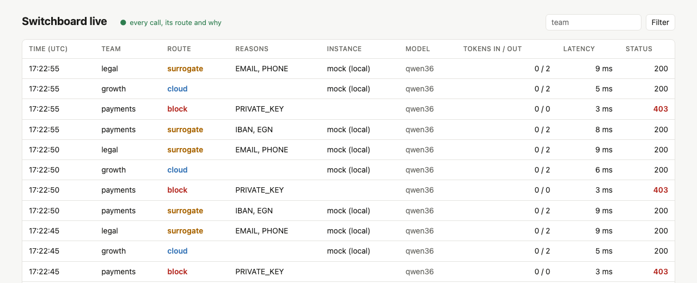

# Switchboard

An AI gateway in Java that keeps sensitive data close to home and measures whether it succeeds.

Every company now wants its teams to use the strongest cloud models without sending out data that
must not leave. Switchboard is the single door all LLM traffic goes through. For every request it
decides where the request may go, sends it there, and records why.

> **Status:** the gateway, the guardian, the ledger and the trace work: both APIs, streaming, the
> in-flight board, surrogates and restore, events, budgets, masked traces and the live view. Leak Lab
> is next (see [Roadmap](#roadmap)).

## Principles

1. **One door.** Clients (applications, AI agents, coding assistants) talk only to Switchboard, in
   the OpenAI or Anthropic API format. Behind the door are cloud and local models; the client does not
   need to know which one answered.
2. **The data decides the route, not convenience.** The more sensitive a request, the closer to home
   it stays. When in doubt, it stays local. If the local model is down, the request fails with a clear
   error and never quietly falls back to the cloud.
3. **Deterministic first, models only where needed.** Checksummed rules catch most sensitive values
   in milliseconds. A decision model is optional and only advises.
4. **A model can only tighten, never loosen.** On the privacy path a decision model may raise the
   risk level, never lower it. A cloud-hosted decision model is not allowed on that path at all.
5. **Measure, don't promise.** Every decision is recorded with its reason, and a built-in red team
   keeps attacking the protection. The result is a number on the dashboard.

## Architecture

```
                         ┌──────────────────────────┐
  client / AI agent ────►│         gateway          │◄──── system-tests (end to end)
  (OpenAI or Anthropic   │                          │◄──── leak-lab (attacks through the door)
   API format)           │  doorman                 │
                         │  + dispatcher            │
                         │  + decision model slot   │
                         │    (optional)            │
                         └──┬──────────┬─────────┬──┘
              REST          │          │         │  HTTP
      /inspect, /restore    │          │         ▼
                            ▼          │   ┌────────────────────────┐
                 ┌────────────────┐    │   │ models                 │
                 │   guardian     │    │   │  local: vLLM, Ollama   │
                 │ guard, judge   │    │   │  cloud: Claude, ...    │
                 └────────────────┘    │   └────────────────────────┘
                                       ▼
                              ┌──────────────────┐
                              │ Redis            │
                              │ in-flight board  │
                              │ per model        │
                              │ instance         │
                              └──────────────────┘

 ═════════════════════════════════ Kafka ═════════════════════════════════
   llm-call-completed       ◄── gateway
   privacy-decision-made    ◄── guardian
   budget-status-changed    ◄── ledger      (compacted, read back by gateway)
   eval-run-completed       ◄── leak-lab
 ═══════╤════════════════════════════╤════════════════════════════════════
        ▼                            ▼
 ┌──────────────┐            ┌──────────────┐
 │    trace     │            │    ledger    │
 │  black box   │            │  accountant  │
 └──────┬───────┘            └──────┬───────┘
        ▼                           ▼
   OpenSearch                   Postgres
   masked traces                prices, spend, budgets
        ▲
        │ REST: what exactly left the boundary
 ┌──────┴───────┐
 │   leak-lab   │──► Postgres (datasets, runs, results)
 │   red team   │
 └──────────────┘
```

### Who does what

| Service | Role | Owns data |
|---|---|---|
| `gateway` | **Doorman and dispatcher.** Authenticates teams, translates the OpenAI and Anthropic formats into one request, asks the guardian for a verdict, picks the least busy healthy model instance inside the allowed set, streams the answer back. Holds the decision model slot for task difficulty | Redis: the in-flight board (shared by all gateway replicas) |
| `guardian` | **Guardian and judge.** Finds sensitive data in every part of the request, has the final word on the route, swaps values for surrogates and restores them, guards agents against the lethal trifecta. Holds the decision model slot for unclear sensitivity, which accepts only a local model. A separate process so the security boundary can be tested and attacked on its own | Nothing at rest |
| `ledger` | **Accountant.** Prices every call, aggregates spend per team, publishes the budget state | Postgres: the system of record for money |
| `trace` | **Black box.** What happened and why; feeds the live view | OpenSearch: masked traces and decisions, never raw sensitive values |
| `leak-lab` | **Red team.** Attacks the protection through the gateway and measures leakage, quality, cost and latency for every strategy | Postgres: datasets, runs, results |
| `mock-llm` | Fake OpenAI-compatible provider for tests and offline demos | No |
| `commons` | Event contracts and shared types | — |
| `system-tests` | End-to-end tests against a deployed system | — |

## The hot path

Example: an agent sends a contract with a Bulgarian national ID (EGN) and an IBAN and asks for a risk summary.

```
client ──► gateway: authenticate, translate into the internal format
              │
              ├──► guardian /inspect ── verdict: SURROGATE, reason: EGN, IBAN
              │    (decision model slot: optional, local only, can only tighten)
              │
              ├── dispatcher inside the gateway (no network hop):
              │     budget ok? → difficulty (decision model slot, optional)
              │     → least busy healthy instance in the allowed set (Redis)
              │
              ├──► cloud model (sees only surrogates)
              │
              ├──► guardian /restore ── real values back, the answer is scanned
              │
client ◄──────┘    header: X-Switchboard-Route: surrogate; reason=IBAN,EGN
              │
              └──► Kafka: llm-call-completed  (asynchronous, off the client's path)
```

The guardian scans every part of the request: system prompt, messages, tool arguments and tool
results, and tool definitions. Patterns find candidates and check digits confirm them: EGN and LNCH
(Bulgarian personal and foreigner IDs), IBAN (mod 97), payment cards (Luhn), email addresses, Bulgarian
phone numbers, API keys by their known prefixes, JWTs and private keys. Each type maps to a route, and
the strictest route among the findings wins. It returns one of five verdicts:

| Verdict | What happens |
|---|---|
| `CLOUD` | Straight to a cloud model |
| `SURROGATE` | Realistic fake values go out, the real ones are restored in the answer |
| `SKETCH` | The cloud model drafts on de-identified text, a local model fills in the real details |
| `LOCAL` | Local model only; fails closed if none is available |
| `BLOCK` | Rejected, e.g. a private key in the prompt |

### A vault that does not exist

Surrogates are deterministic: `HMAC(conversation key, real value)` becomes a fake value of the same
type that still passes its check digits, so the model reasons about it as it would about the real one.
Chat APIs resend the whole history on every turn, so the guardian sees the real values again and turns
them into the same surrogates. To restore an answer, the gateway sends the original request along and
the guardian rebuilds the mapping, so nothing is stored, not even between the two calls. For the same
reason sensitivity sticks to a conversation without being remembered: the value is still in the
history. The key is derived from the conversation's first message, so a provider cannot link the same
value across conversations. A surrogate that would collide with a real value or with another
surrogate is derived again.

If the guardian does not answer, the gateway sends nothing (503). A `LOCAL` request only ever goes to
instances marked local; when they all fail, the client gets an error, never a quiet trip to the cloud.
A streamed surrogate answer is restored as it arrives: the guardian hands the gateway the
substitutions for this one request, and the gateway holds back only a short tail that could still be
the start of a split surrogate. The response scan needs the whole answer, so only non-streamed answers
carry `X-Switchboard-Response-Findings`.

Models rewrite values: an EGN with dashes between the digits, an IBAN in lower case or without spaces,
a phone number with `0` instead of `+359`. Restore finds a surrogate written with spaces, dots or
dashes and in any letter case, and puts the real value back in the model's spacing.

### The in-flight board

Redis has exactly one job: a shared board of how many requests each model instance is working on
right now. A small Lua script reads the board, picks the least busy instance and increments its
count in one atomic step, so several gateway replicas never pile onto the same instance while another
is idle. Local models serve only a few requests at once, so this has a direct effect on latency.
Counts are leases with a TTL, so a crashed gateway cannot leave an instance marked busy forever. If
Redis is down, each replica falls back to counting its own requests; a circuit breaker
(resilience4j) then skips Redis for a while (`switchboard.board.redis-retry-after`, 10s), so requests
do not each wait for a Redis timeout.

### Lethal trifecta guard

An agent that has private data, reads untrusted content and can send data out can be tricked into
leaking it ([Simon Willison](https://simonwillison.net/2025/Jun/16/the-lethal-trifecta/)). The gateway
sees the agent's tool list in every request and the guardian knows whether the conversation holds
sensitive data. When all three meet, the outbound tool is removed, an approval is required, or the
route becomes `LOCAL`.

## Events

| Topic | Published by | Consumed by |
|---|---|---|
| `llm-call-completed` | gateway | ledger, trace |
| `privacy-decision-made` | guardian | trace |
| `budget-status-changed` | ledger | gateway (compacted topic held in memory), trace |
| `eval-run-completed` | leak-lab | trace |
| `<consumer>-dlq` | every consumer | redrive endpoint |

The contracts live in [`commons`](commons/src/main/java/io/github/timganev/switchboard/commons).
Privacy events carry the type and count of what was found, never the value.

The gateway publishes one `llm-call-completed` for every call however it ends (answered, blocked,
refused, failed), keyed by team; the guardian publishes one `privacy-decision-made` for every verdict,
under the same call id (`X-Switchboard-Call-Id`). Events go out on a virtual thread, so a slow or
missing broker never delays or fails a request. Until teams authenticate, the team comes from the
`X-Switchboard-Team` header (`default` when absent) and the session from `X-Switchboard-Session`.

### Budgets

The ledger prices every call into Postgres (schema by Liquibase). Local calls cost nothing; a cloud
call is priced with the price valid at the time (`model_price`, one row per model and start date,
with a fallback row `*` so a model without a price is never free). The call id is the primary key,
so a redelivered event is counted once. After every call the ledger publishes the team's status for
the month (`OK`, `WARN` from 80%, `BLOCKED` at the limit) to the compacted `budget-status-changed`
topic. Each gateway replica reads that topic from the beginning into memory, so no lookup sits on
the request path. A team over its budget may still use local models (`X-Switchboard-Budget: spent;
local only`); without a local instance it gets a 429 with the reason. The budget fails open while
the topic is unread, because it is a cost control; privacy stays fail-closed.

```bash
curl -X PUT localhost:8082/v1/budgets/payments -H 'Content-Type: application/json' -d '{"monthlyLimitUsd": 50}'
curl localhost:8082/v1/budgets/payments
```

### Traces

The trace service merges both events of a call into one OpenSearch document: route, instance,
tokens, latency, status, and the guardian's verdict with the types and counts it found. Nothing in it
is a sensitive value, because nothing in the events is.

```bash
curl 'localhost:8083/v1/calls?team=payments&limit=20'   # newest first
curl localhost:8083/v1/calls/<call id>
```

### Live view

The trace service also serves the console at `localhost:8083`: the latest 50 calls rendered on the
server (Thymeleaf), then each new call pushed over server-sent events as an HTML row that htmx puts at
the top of the table. A row is pushed once the call has finished and is replaced when the guardian's
decision arrives later, so it is complete whichever event came first. `?team=payments` narrows both
the table and the stream. No Node toolchain: the page is one template.



A record a consumer cannot process is retried twice and then parked on `<consumer>-dlq` (raw bytes if
it could not even be read), so one bad record never blocks a partition.

## Leak Lab

A second model receives exactly what left the boundary and tries to recover what was hidden or to
re-identify the person from what is left (age, job and town are often enough). Every strategy, from
no protection through placeholders and surrogates to `LOCAL`, is scored on four numbers: leakage,
answer quality, cost and latency. The goal is a privacy versus utility chart in this README, backed
by a reproducible run.

## Repository layout

```
switchboard/
├── commons/        event contracts and shared types
├── gateway/        doorman, dispatcher, decision model slot
├── guardian/       privacy guard and judge
├── ledger/         prices, spend, budgets
├── trace/          masked traces, live view
├── leak-lab/       red team and evaluations
├── mock-llm/       fake OpenAI-compatible provider
├── system-tests/   end-to-end tests against a deployed system
└── deploy/         Dockerfile and docker compose
```

| Service | Port |
|---|---|
| gateway | 8080 |
| guardian | 8081 |
| ledger | 8082 |
| trace | 8083 |
| leak-lab | 8084 |
| mock-llm | 8090 |

## Getting started

Requires Java 25. Maven comes with the wrapper.

```bash
./mvnw verify                                   # build and run the tests
./mvnw -B package -DskipTests                   # build the jars
docker compose -f deploy/compose.yml up -d      # infrastructure and all services
curl localhost:8080/actuator/health
```

The system tests read each service's base URL from an environment variable, for example
`GATEWAY_BASE_URL=http://localhost:8080`, and skip a service whose variable is not set.

### Try it without Docker

The gateway forwards to the OpenAI-compatible instances listed under `switchboard.backend.instances`
(by default one local instance: the fake provider on port 8090). Each instance has a `name`, a `url`,
an optional `api-key`, an optional `model` that replaces the client's model name, and a `locality`
(`LOCAL` or `CLOUD`; unset counts as cloud). Without Redis each gateway counts its own requests; set
`switchboard.board.type=redis` to share the board.

```bash
./mvnw -B package -DskipTests
java -jar mock-llm/target/mock-llm-0.1.0-SNAPSHOT.jar &
SWITCHBOARD_GUARDIAN_SECRET=a-long-random-secret-of-32-chars-or-more java -jar guardian/target/guardian-0.1.0-SNAPSHOT.jar &
java -jar gateway/target/gateway-0.1.0-SNAPSHOT.jar &
# Optional: events, budgets and traces need Kafka, Postgres and OpenSearch
docker compose -f deploy/compose.yml up -d kafka postgres opensearch
java -jar ledger/target/ledger-0.1.0-SNAPSHOT.jar &
java -jar trace/target/trace-0.1.0-SNAPSHOT.jar &

curl localhost:8080/v1/chat/completions -H 'Content-Type: application/json' \
  -d '{"model": "qwen36", "messages": [{"role": "user", "content": "Hi"}]}'

curl localhost:8080/v1/messages -H 'Content-Type: application/json' \
  -d '{"model": "qwen36", "max_tokens": 100, "system": "Be brief.", "messages": [{"role": "user", "content": "Hi"}]}'

curl -N localhost:8080/v1/messages -H 'Content-Type: application/json' \
  -d '{"model": "qwen36", "max_tokens": 100, "stream": true, "messages": [{"role": "user", "content": "Hi"}]}'

# The verdict and its reasons come back in a header; the guardian shows what would leave
curl -i localhost:8080/v1/chat/completions -H 'Content-Type: application/json' \
  -d '{"model": "qwen36", "messages": [{"role": "user", "content": "Risks for EGN 7501020018?"}]}'
curl localhost:8081/v1/inspect -H 'Content-Type: application/json' \
  -d '{"model": "qwen36", "messages": [{"role": "USER", "parts": [{"type": "text", "text": "Risks for EGN 7501020018?"}]}]}'
```

## Roadmap

- [x] **Skeleton:** all services start and report health, event contracts, fake provider, CI
- [ ] **1. Door and dispatcher:** coding agents work through Switchboard by changing only the base URL
  - [x] OpenAI and Anthropic formats through one internal model: text, system prompt, tool calls and results
  - [x] Both APIs forward to an OpenAI-compatible backend, with timeouts and errors in the caller's format
  - [x] Streaming in both formats; a backend error before the first byte is still a clean 502
  - [x] The in-flight board across local instances and a cloud provider, with retry inside the allowed set
  - [ ] Images and other multimodal content
- [ ] **2. Guardian:** deterministic detectors, deterministic surrogates and restore, fail-closed local route
  - [x] Detectors with check digits, a route per type, surrogates that pass the same checks, restore without storage
  - [x] Fail closed: no verdict means nothing is sent; a local request never leaves the local instances
  - [x] The answer is scanned for sensitive data the model produced on its own (`X-Switchboard-Response-Findings`)
  - [x] Restore inside a live stream, even when a surrogate is split across chunks
  - [x] Surrogates the model rewrites: separators, letter case, another phone prefix
  - [ ] High-entropy secrets without a known prefix
- [ ] **3. Events:** ledger with budgets, trace, live view
  - [x] `llm-call-completed` from the gateway and `privacy-decision-made` from the guardian, off the request path
  - [x] Ledger: versioned prices, idempotent spend per team in Postgres, budget states on a compacted topic
  - [x] Gateway: a team over its budget is kept on local models, or refused with the reason
  - [x] Dead letter topics for consumers
  - [x] Trace: the call and its privacy decision merged into one masked document in OpenSearch
  - [x] Live view: every call with its route and reasons, pushed to the browser as it finishes
  - [ ] Redrive endpoint for dead letters; reconciling the estimate with the provider's bill
- [ ] **4. Leak Lab and the decision model slot:** leakage, quality, cost and latency per strategy
- [ ] **5. Hardening:** `SKETCH`, lethal trifecta guard, Helm charts, system tests in Kubernetes, Allure reports

**To decide**
- [ ] **Adaptive limits on top of the board.** The board counts requests, but the safe limit per
      instance is configured by hand. An AIMD controller (like TCP congestion control) could learn it
      from latency, 429 and 503, and also notice load that does not come through Switchboard. The learned
      limits would live next to the board in Redis.

## Tech stack

Java 25, Spring Boot 4, Kafka, Postgres with Liquibase, Redis, OpenSearch, Keycloak, Testcontainers,
WireMock, Docker, Helm, GitHub Actions.

## License

[Apache License 2.0](LICENSE)
